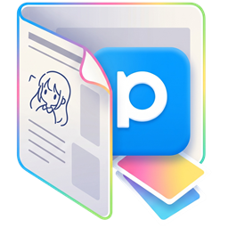
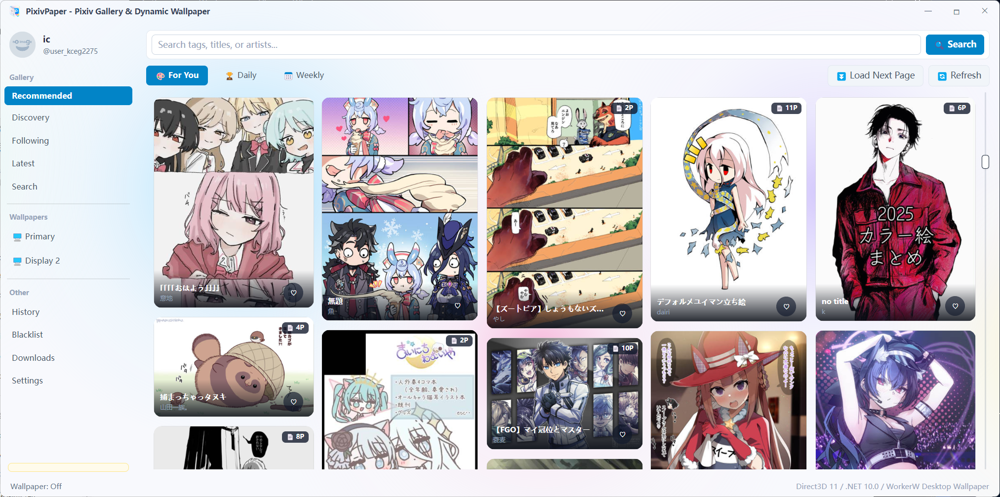
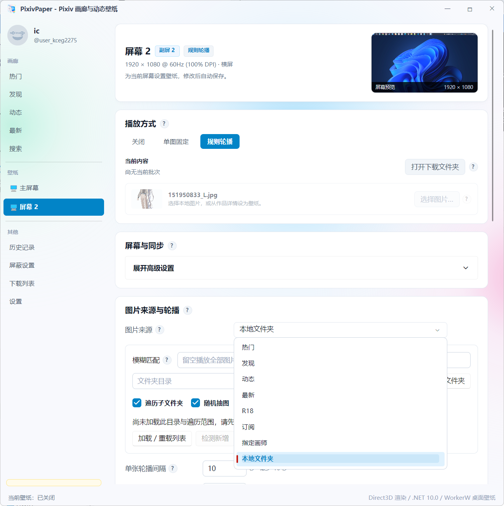
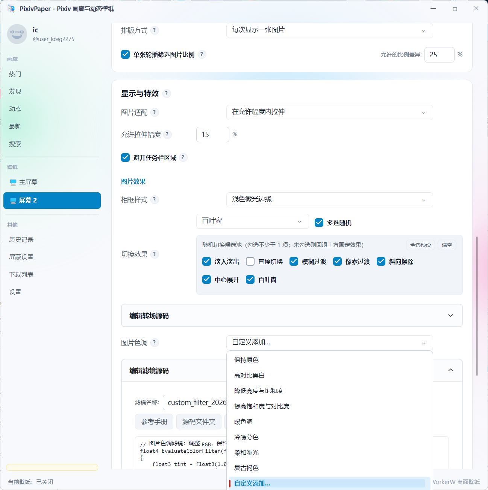
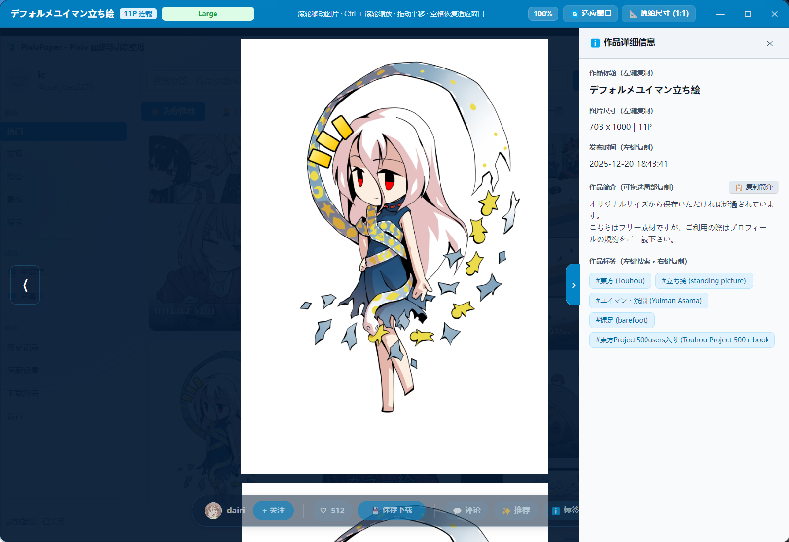
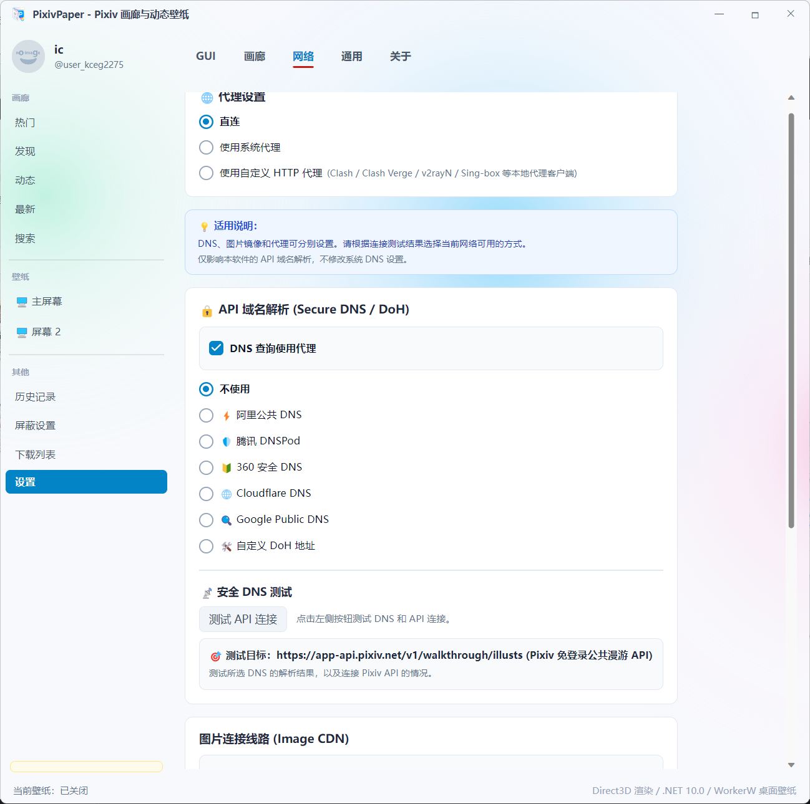

# PixivPaper

 

 

**PixivPaper** is a native Windows Pixiv gallery client & Direct3D 11 multi-monitor wallpaper engine — masonry browsing, Ugoira, slideshows, search subscriptions, smart collage wallpapers, and live HLSL shaders in one lightweight app without Electron bloat.

Windows 10 (1809+) / Windows 11 x64 · NativeAOT · Built-in DoH & CDN mirror test · Free & ad-free

---

[简体中文](./README.md) | **English** | [日本語](./README.ja.md) | [🖼️ Visual Showcase](./SHOWCASE.md) | [🗺️ Update Plan](./更新计划.md)

> [!NOTE]
> **Public Preview & Open-Source Notice**: This is an unofficial third-party desktop client for [Pixiv](https://www.pixiv.net). All artworks belong to their respective creators or Pixiv.
> PixivPaper is currently in **Public Preview (Pre-1.0)** — hosting preview binary releases and issue tracking while UI and stability are polished. The preview client currently includes a preliminary **Chinese / English / Japanese** UI pass (some newer preview panels may fall back to Chinese while UI iterates), and **full copy polishing plus additional languages will be rolled out in v1.0**. Full source code will be open-sourced upon the official **v1.0** release.

 

  
   
  🎬 <b>Live Desktop Wallpaper Demo</b>: Jump to <a href="./SHOWCASE.md#wallpaper-live-demo"><code>SHOWCASE.md</code> for the live D3D11 wallpaper GIF (paper.gif)</a> &nbsp;|&nbsp; 📷 <a href="./SHOWCASE.md">View all 14 screenshots</a>

---

## ✨ Features

### Browse Pixiv and send artworks straight to your desktop
From discovery, filtering, and search subscriptions to multi-monitor D3D11 wallpapers — everything lives in one cohesive native app.

<table>
<tr>
<td width="50%" valign="top">

#### 🎯 Smooth Masonry · Instant Cold Start
Recommendations cache the first-page snapshot to disk for instant startup while refreshing quietly in the background. Bucketed sliding-window virtualization keeps large galleries light in memory, with configurable scroll speed (100% / 250% / 500%) and keyboard navigation.

#### 🏆 Rankings & Full Discovery
Recommendations, Daily / Weekly / Monthly / Original / Rookie rankings, Following feed, Latest uploads, R-18 rankings, My Space (Home / Bookmarks / Following / Works), and a History Center tracking browsing, wallpaper, and recommendation history.

#### 🔍 Advanced Search & Filtering
Translated/synonym tag matching toggle, date range, age rating, premium-aware popularity routing, artist lookup, and direct Artwork ID search — plus quick access to Pixiv's viewing settings.

#### 🎬 Detail Viewer · Ugoira · Slideshow
Thumbnail placeholder followed by target-quality decoding, multi-page viewing, native **Ugoira** playback and GIF export, plus a configurable **Slideshow Mode** with dedicated multi-page stepping and Ugoira loop rules. Detail windows keep loading along their original feed even after switching main tabs.

#### 🙈 Layered Local Blocking
Manual banned tags backed by SQLite with **persistent history & one-click restore**, plus editable **Blocked Tag Sets** (presets, custom sets, per-tag toggles, JSON/TXT import & export). Quick-add or preview-block artists by UID, with per-scene filter controls.

#### 📦 Search Subscriptions & Downloads
Save any search query as a subscription with dry-run candidate preview and scheduled background archiving into isolated subfolders. Unified download queue with source filtering, atomic commits, and verified directory migration.

</td>
<td width="50%" valign="top">

#### 🖥️ Isolated D3D11 Wallpaper Host
Desktop rendering runs in a separate `PixivPaper.ScreenHost` process attached via `WorkerW` + DirectComposition / Direct3D 11, staying active in the tray even when the main window is closed.

#### 🧩 Multi-Monitor Control & Sync
Configure pinned artworks or rotation rules per monitor, link screens into sync groups with shared feed stepping (no duplicate images across screens), avoid the taskbar work area, choose GPU adapters, and **auto-pause during fullscreen games**.

#### 🌊 8 Source Groups / 18 Stream Paths
Recommendations, Rankings, Following, Latest, R-18 charts, Custom Search Queries, Specific Artists, and **Local Folder Indexing** (parsing filenames and Windows file properties with new-file detection).

#### 🎨 Smart Fitting & 5 Collage Layouts
Single-image modes include tolerance-based stretch, aspect-fit, crop, and 1:1 original, with aspect-mismatch & strip filtering. Includes 5 collage layouts: **Adaptive News**, **Art Wall** (zero-crop), **Justified Rows**, **Side by Side**, and **Stacked**.

#### 🧪 Live In-App HLSL Shader Editor
Want custom shaders? Edit **background, transition, and color-filter** HLSL code directly inside the app with compile-on-save validation and a modeless built-in shader reference manual.

#### 📡 Network Tools · DoH & CDN Speed Test
Official WebView2 OAuth login with token refresh; Direct / System / Custom HTTP proxy; built-in **DoH presets** and **image CDN mirrors** with one-click latency tests.

</td>
</tr>
</table>

---

## 🖼️ D3D11 Wallpaper Engine & HLSL Shaders

### More than just swapping static images
A hardware-accelerated rendering pipeline turns empty margins into ambient art frames.

> 🎞️ **Live Wallpaper Demo**: **[Jump to `paper.gif` live wallpaper & shader preview →](./SHOWCASE.md#wallpaper-live-demo)**

<table>
<tr>
<td width="50%" valign="top">

#### 🌌 11+ Animated Backgrounds
- Pure Color, Ambient Aurora (Dark / Light), Deep Space Starlight, Polaris
- Side Soft Glow, Side Floating Motes, Flowing Ribbons, Fine Light Trails, Ocean Caustics, Soft Prism
- Custom background images & custom HLSL background shaders

#### 🎞️ Transitions, Frames & Filters
- **Transitions**: Instant Cut, Cross Fade, Pixel Morph, Bokeh Blur, Diagonal Wipe, Iris Reveal, Window Blinds
- **Frames**: None, Glow Strip, Classic Frame
- **Color Filters**: Original, Manga Monochrome, Midnight Muted, Vibrant Pop, Warm Paper, Split Tone, Soft Matte, Sepia Print

</td>
<td width="50%" valign="top">

#### ⚡ Live HLSL Customization
- `WallpaperShaderCompiler` compiles on save and keeps the previous working shader on error
- Exposes `%TIME%`, `%PROGRESS%`, `%SCREEN_WIDTH%`, `%IMG_RECT%` macros and texture samplers
- Built-in modeless `ShaderHelpWindow` for quick reference while editing

#### 🚀 Native Architecture · No Electron
- Built on **.NET 10 NativeAOT** and **Avalonia 11 + FluentAvalonia**
- Companion cross-platform `BroadcastServer` console host (LAN discovery + read-only JSON API)

</td>
</tr>
</table>

---

## 📱 Interface

### Built for real desktop workflows
Here is a quick tour of the core feature screens. For all 14 screenshots and the live wallpaper GIF demo, open the [Full Visual Showcase (SHOWCASE.md)](./SHOWCASE.md).

<table>
<tr>
<td align="center" width="50%">
  
   <b>Wallpaper Control · Multi-Monitor & Sources</b>
   Per-monitor config · Source selection · Rotation & resolution filters
</td>
<td align="center" width="50%">
  
   <b>Visual Effects · Live HLSL Editor</b>
   Background / transition / filter shaders · Compile on save · <a href="./SHOWCASE.md#wallpaper-live-demo">Watch GIF Demo</a>
</td>
</tr>
<tr>
<td align="center" width="50%">
  
   <b>Artwork Viewer · Bilingual Tags & Details</b>
   Multi-page viewer · One-click wallpaper & bookmark · Tag / artist metadata
</td>
<td align="center" width="50%">
  
   <b>Connectivity · Proxy, DoH & CDN Benchmark</b>
   Bypass SNI / proxy profiles · Auto CDN node racing · Live latency check
</td>
</tr>
</table>

  <a href="./SHOWCASE.md#wallpaper-live-demo"><b>🎞️ Jump to Live Wallpaper Demo (paper.gif)</b></a> ·
  <a href="./SHOWCASE.md"><b>🖼️ View All 14 Screenshots & Full Feature Gallery →</b></a>

<b>More details about each area</b>

 

- **Masonry Gallery** — Disk-cached first page for Recommendations with background refresh; supports Rankings, Following, Latest, and R-18 sections using bucketed sliding-window virtualization.
- **Wallpaper Engine & Collages** — Out-of-process `ScreenHost` renderer with 8 source groups (including local folder indexing), independent single/multi-image rotation intervals, multi-screen sync, and fullscreen game auto-pause.
- **HLSL Customization** — Expandable HLSL editors for backgrounds, transitions, and color filters directly inside wallpaper settings with instant compilation and a non-blocking syntax reference window.
- **Viewer & Slideshow** — Progressive image loading, Ugoira loop-boundary slideshow stepping, customizable sub-second fast paging for multi-page works, and optional Ugoira prefetching.
- **Filtering & Subscriptions** — Shareable/importable tag sets, SQLite tag history restore, and search subscriptions with isolated download subfolders and protocol/state separation.

---

## ⬇️ Download & Getting Started

### Requirements

- **OS**: Windows 10 (version 1809 / Build 17763 or later, x64) or Windows 11
- **Runtime**: [Microsoft Edge WebView2 Runtime](https://developer.microsoft.com/microsoft-edge/webview2/) (pre-installed on Windows 11)
- **GPU**: Direct3D 11 capable graphics adapter

### Quick Start

1. Download the latest `win-x64` preview archive from [GitHub Releases](https://github.com/ic3nya/PixivPaper/releases/latest).
2. Extract all files into a folder (keep `PixivPaper.exe`, `PixivPaper.ScreenHost.exe`, and `default-blocked-tag-presets.json` together).
3. Launch **`PixivPaper.exe`** and sign in via the built-in WebView2 Pixiv login window.

---

## ❓ FAQ

<b>Is PixivPaper an official Pixiv app?</b>
 No. PixivPaper is an unofficial third-party Pixiv desktop client and wallpaper engine. All artworks belong to their creators or Pixiv — please use for personal enjoyment only.

<b>Why are only preview binaries available right now? When will it be open-sourced?</b>
 PixivPaper is currently in <b>Public Preview (Pre-1.0)</b> while features and multi-monitor edge cases are being finalized. We plan to open-source the full codebase when the official <b>v1.0</b> release ships.

<b>What languages are supported? Will more languages be added?</b>
 The preview client currently provides a preliminary <b>Chinese / English / Japanese</b> UI (while preview UI is still evolving, some newly added panels may fall back to Chinese); <b>full localization polishing and additional languages will be rolled out in the official v1.0 release</b>. This README is also available in Chinese, English, and Japanese.

<b>Why does Windows SmartScreen show an "Unknown publisher" warning?</b>
 Preview builds do not yet carry a paid commercial code-signing certificate. Please verify the <code>SHA-256</code> checksum on the Release page, then click <b>More info → Run anyway</b>. Login uses Pixiv's official WebView2 OAuth flow, and tokens/settings are stored locally under <code>%LocalAppData%\PixivPaper\</code>.

<b>Does it use a lot of memory or affect gaming performance?</b>
 No. Both the main app and the D3D11 wallpaper host are compiled with .NET 10 NativeAOT (no Electron/Chromium runtime overhead per window), and wallpaper rendering <b>automatically pauses when fullscreen games or apps are detected</b>.

<b>Is it free and ad-free?</b>
 Yes — completely free and ad-free. Sponsorship links are also not enabled during the preview phase.

<b>How do I report bugs or crashes?</b>
 Please open an <a href="https://github.com/ic3nya/PixivPaper/issues">Issue</a> with reproduction steps. If a crash occurs, attaching <code>%LocalAppData%\PixivPaper\logs\crash.log</code> (with personal paths redacted) is very helpful.

---

## 🗺️ Roadmap & Open-Source Milestone

> 📋 **See the full upcoming checklist in [更新计划.md](./更新计划.md)**

- [x] **Core Engine Complete**: Avalonia masonry gallery, isolated D3D11 multi-monitor wallpaper host, live HLSL editor, search subscriptions & layered filtering
- [ ] **Public Preview Testing (Current)**: Gather real-world multi-monitor, GPU, network, and UX feedback
- [ ] **Upcoming Priorities** (tracked in [更新计划.md](./更新计划.md)):
  1. Memory management optimization
  2. Subscription server & receiver workflow completion
  3. Wallpaper engine polish, performance & logic optimization ← **Open-source milestone upon completion**
  4. Warm-up / prefetch strategy improvements for high-latency users
  5. Localization refinement and progressive support for additional languages
- [ ] **Full Open Source**: Open-source the complete codebase once step 3 (wallpaper engine, performance & logic optimization) is complete

---

**Try the preview build, share your feedback, and follow our [Update Plan](./更新计划.md) toward open source!**

&nbsp;

Powered by <a href="https://avaloniaui.net/">Avalonia</a> · <a href="https://github.com/amwx/FluentAvalonia">FluentAvalonia</a> · <a href="https://github.com/amerkoleci/Vortice.Windows">Vortice.Windows</a> · <a href="https://github.com/mono/SkiaSharp">SkiaSharp</a>

