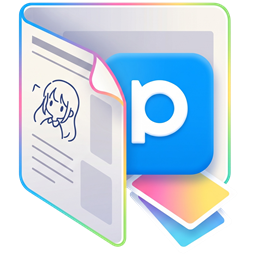
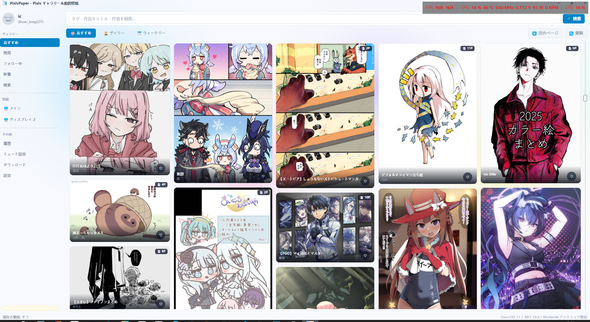
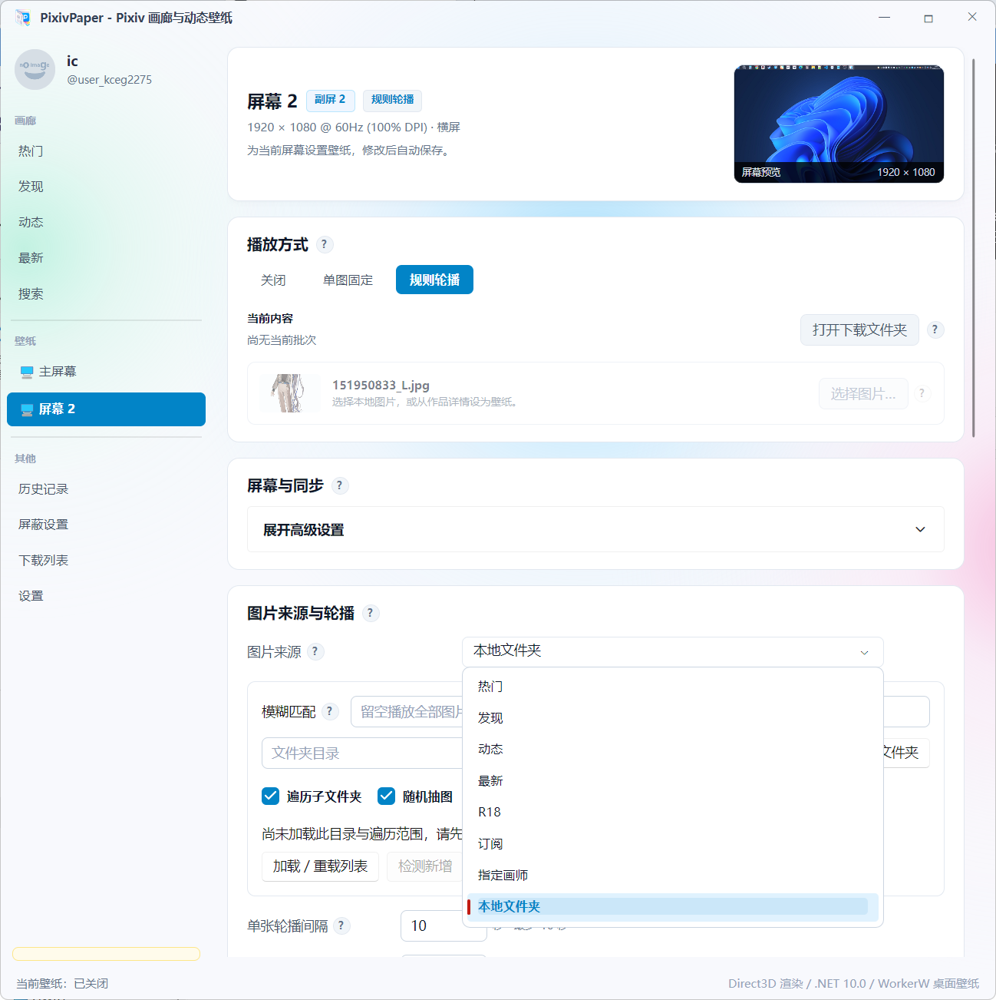
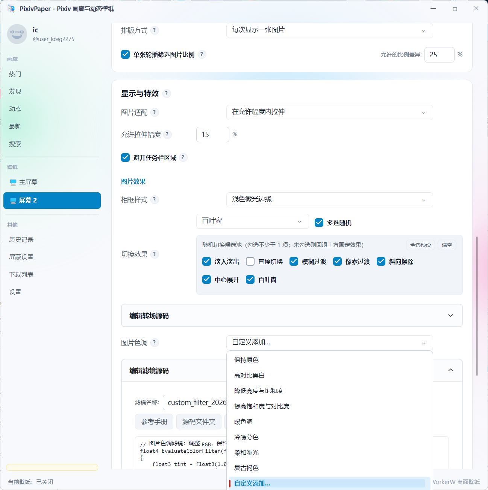
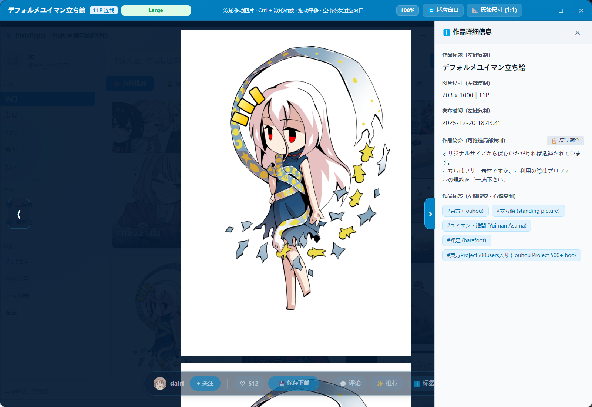
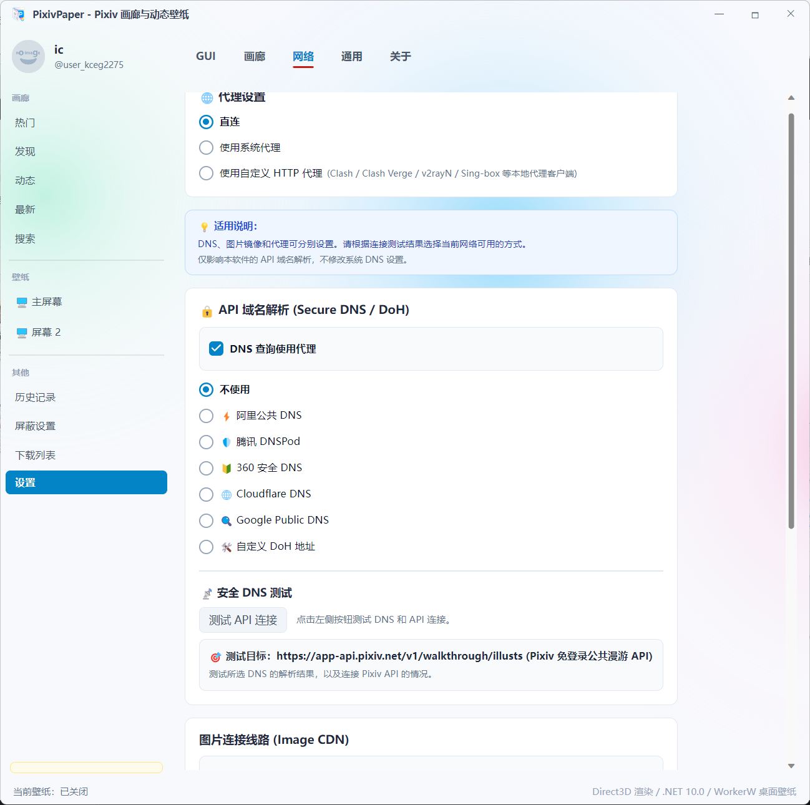

# PixivPaper

 

 

**PixivPaper** は、Windows 向けのモダンな Pixiv ギャラリークライアント ＆ Direct3D 11 マルチモニター壁紙エンジンです。ウォーターフォール閲覧・うごイラ・スライドショー・検索サブスク・マルチ画像コラージュ壁紙・リアルタイム HLSL シェーダーを Electron なしのネイティブ動作でひとつに。

Windows 10 (1809+) / Windows 11 x64 対応 · NativeAOT · DoH / CDN ミラー速度テスト内蔵 · 無料・広告なし

---

[简体中文](./README.md) | [English](./README.en.md) | **日本語** | [🖼️ 画面・GIF ギャラリー](./SHOWCASE.md) | [🗺️ 更新計画](./更新计划.md)

> [!NOTE]
> **パブリックプレビュー ＆ オープンソース計画**：本アプリは [Pixiv](https://www.pixiv.net) の非公式サードパーティ製デスクトップクライアントです。すべてのイラスト・うごイラの著作権は各クリエイターまたは Pixiv に帰属します。
> 現在は **パブリックプレビュー段階（Pre-1.0）** のため、実行ファイルの配布とフィードバック受付のみ行っています。プレビュー版では **簡体字中国語 / English / 日本語** の暫定 UI に対応しています（UI 調整中のため一部の新機能画面は中国語のまま残る場合があり、**正式版 v1.0 で文言の全面整備とさらなる多言語対応を実施予定です**）。**正式版（v1.0）のリリース時**に全ソースコードを公開する予定です。

 

  
   
  🎬 <b>デスクトップ動的壁紙の実機デモ</b>：<a href="./SHOWCASE.md#wallpaper-live-demo"><code>SHOWCASE.md</code> で壁紙エンジンのデモ GIF（paper.gif）を見る</a> &nbsp;|&nbsp; 📷 <a href="./SHOWCASE.md">全 14 枚のスクリーンショット一覧</a>

---

## ✨ 特徴

### Pixiv 巡回からデスクトップ壁紙まで、ひとつで完結
作品の発見、絞り込み、定期収集からマルチモニター向け D3D11 壁紙描画まで、デスクトップ向けの体験を一貫して作り込みました。

<table>
<tr>
<td width="50%" valign="top">

#### 🎯 滑らかな表示 · 高速コールドスタート
おすすめフィードは先頭ページのディスクキャッシュにより起動直後から即座に表示し、バックグラウンドで最新化。バケット仮想化により大量読み込み時も軽快で、スクロール倍率（100% / 250% / 500%）やキーボード操作に対応します。

#### 🏆 ランキング ＆ 充実した閲覧機能
おすすめ、デイリー／ウィークリー／マンスリー／オリジナル／ルーキーランキング、フォロー新着、最新投稿、R-18 ランキング、マイページ（ホーム／ブックマーク／フォロー／投稿）、閲覧・壁紙・おすすめ履歴センターを搭載。

#### 🔍 高度な検索 ＆ タグ絞り込み
類義語・翻訳タグ統合のオン／オフ、投稿期間指定、年齢制限、アカウント権限に応じた人気順検索、ユーザー検索、作品 ID ダイレクト検索に対応。Pixiv 公式の閲覧設定ページにもすぐアクセスできます。

#### 🎬 高画質ビューア · うごイラ · スライドショー
サムネイル先行表示からの高画質切替、複数ページ閲覧、**うごイラ**再生＆ GIF エクスポートに対応。**詳細スライドショー**では複数ページの送り方やうごイラの 1 ループ完了待ちも細かく設定でき、メインタブを切り替えても詳細側の続き読み込みを継続できます。

#### 🙈 多層ローカルブロック管理
SQLite 永続化＋**削除履歴からのワンクリック復元**を備えた手動タグブロックと、編集可能な**ブロックタグセット**（プリセット／カスタム／個別無効化／JSON・TXT 入出力）を搭載。UID 直入力・プレビュー確認での絵師ブロックや画面別の適用制御も行えます。

#### 📦 検索サブスクリプション ＆ ダウンロード管理
検索条件をサブスク保存し、ドライランで候補を確認した上で専用フォルダへ定期自動保存。手動とサブスクを統一キューで管理でき、アトミック書き込みと検証付きフォルダ移行を備えています。

</td>
<td width="50%" valign="top">

#### 🖥️ 独立 D3D11 壁紙レンダリングプロセス
描画は別プロセス `PixivPaper.ScreenHost` が担い、`WorkerW` と DirectComposition / Direct3D 11 でデスクトップに直接描画。メイン画面を閉じてトレイ常駐させても壁紙は独立して動作します。

#### 🧩 マルチモニター個別設定 ＆ 同期
モニターごとに固定表示または自動切替を設定でき、同期グループによる重複なしの連続取得、タスクバー回避、GPU アダプタ指定、**フルスクリーンゲーム検知時の自動一時停止**に対応。

#### 🌊 8 グループ / 18 種類の壁紙ソース
おすすめ、各種ランキング、フォロー新着、最新投稿、R-18、検索条件指定、特定絵師に加え、**ローカルフォルダ参照**（ファイル名や Windows プロパティのインデックス化・新規ファイル自動検出）が選べます。

#### 🎨 フィット調整 ＆ 5 種類のコラージュ配置
単体表示は許容ストレッチ／アスペクト比維持／トリミング／原寸に対応し、極端な縦長・比率違いの作品も自動除外可能。**Adaptive News**・**Art Wall**（切り抜きなし）・**Justified Rows**・**Side by Side**・**Stacked** の 5 種類のコラージュを内蔵。

#### 🧪 アプリ内リアルタイム HLSL エディタ
**背景・トランジション・カラーフィルター**の HLSL シェーダーコードをアプリ内で直接編集でき、保存時に即時コンパイル検証。モードレスのシェーダーリファレンス画面も同梱しています。

#### 📡 ネットワーク診断 · DoH ＆ CDN 速度測定
WebView2 による公式 OAuth ログインと自動トークン更新に対応。直結／システム／カスタム HTTP プロキシ、複数 **DoH プリセット**、**画像 CDN ミラー**の速度テストを内蔵。

</td>
</tr>
</table>

---

## 🖼️ D3D11 壁紙エンジンと HLSL エフェクト

### ただ画像を切り替えるだけではない、GPU ベースの背景演出
ハードウェアアクセラレーションにより、余白の演出から画面切替まで滑らかにカスタマイズできます。

> 🎞️ **動的壁紙の動作デモ**：**[`paper.gif` ライブ壁紙・シェーダー演出を見る →](./SHOWCASE.md#wallpaper-live-demo)**

<table>
<tr>
<td width="50%" valign="top">

#### 🌌 11 種類以上の動的背景
- 単色、アンビエントオーロラ（ダーク／ライト）、ディープスペース星空、ポラリス
- サイドソフトグロウ、浮遊パーティクル、フローイングリボン、ライトトレイル、オーシャンコースティクス、ソフトプリズム
- カスタム背景画像 ＆ カスタム HLSL 背景シェーダー対応

#### 🎞️ トランジション・額縁・フィルター
- **トランジション**：カット、クロスフェード、ピクセル再構成、ボケブラー、斜めワイプ、アイリス展開、ブラインド
- **額縁**：なし、グロウストリップ、クラシック額縁
- **フィルター**：オリジナル、モノクロ漫画調、ミッドナイト暗調、ビビッド強調、ウォームペーパー、スプリットトーン、ソフトマット、セピア調

</td>
<td width="50%" valign="top">

#### ⚡ リアルタイム HLSL カスタマイズ
- `WallpaperShaderCompiler` により保存時コンパイルを実行、エラー時は直前の正常シェーダーを維持
- `%TIME%`、`%PROGRESS%`、`%SCREEN_WIDTH%`、`%IMG_RECT%` などのマクロとテクスチャサンプラーを公開
- `ShaderHelpWindow` で構文や定数を参照しながら編集可能

#### 🚀 ネイティブ設計 · Electron 不使用
- **.NET 10 NativeAOT** と **Avalonia 11 + FluentAvalonia** で構築
- クロスプラットフォーム対応のコンソールホスト `BroadcastServer`（LAN 検出＋読み取り専用 JSON API）も用意

</td>
</tr>
</table>

---

## 📱 スクリーンショット

### 実機画面プレビュー
代表的な画面を抜粋しています。3 言語 UI・右クリック／スライドショー・検索＆サブスク・ブロック管理および **デスクトップ壁紙デモ GIF** は 👉 [**実機スクリーンショット＆デモ集 (`SHOWCASE.md`)**](./SHOWCASE.md) をご覧ください。

<table>
<tr>
<td align="center" width="50%">
  
   <b>デスクトップ壁紙 · マルチモニター＆ソース</b>
   モニターごとの個別設定 · ランキング / 購読 / 作者 / ローカルフォルダ対応
</td>
<td align="center" width="50%">
  
   <b>エフェクト編集 · リアルタイム HLSL エディタ</b>
   ランダム切替プール · フィルターソース直編集＆即時コンパイル
</td>
</tr>
<tr>
<td align="center" width="50%">
  
   <b>詳細ビューア · 作品情報＆タグ表示</b>
   オリジナル／複数ページ閲覧 · ワンクリックコピー · タグ検索
</td>
<td align="center" width="50%">
  
   <b>ネットワーク · プロキシ / DoH / CDN 計測</b>
   直接接続・システム・カスタム HTTP プロキシ · DoH＆CDN 速度テスト
</td>
</tr>
</table>

  <a href="./SHOWCASE.md#wallpaper-live-demo"><b>🎬 デスクトップ壁紙の実機デモ GIF (paper.gif) を見る</b></a> &nbsp;·&nbsp; <a href="./SHOWCASE.md"><b>📷 全 14 枚のスクリーンショットを見る →</b></a>

<b>各機能の詳細を見る</b>

 

- **ギャラリー** —— おすすめ先頭ページのディスクキャッシュによる高速表示とバックグラウンド更新。ランキング、フォロー新着、最新投稿、R-18 を含め仮想化スクロールで快適に閲覧できます。
- **壁紙エンジン** —— 独立した `ScreenHost` プロセスで 8 グループのソース（ローカルフォルダ含む）を描画。単体／マルチごとの更新間隔設定、モニター間同期、フルスクリーンゲーム時の一時停止を備えています。
- **HLSL エディタ** —— 壁紙設定内で背景・トランジション・フィルターのソースを展開して編集可能。保存と同時にコンパイル検証を行い、別ウィンドウのリファレンスを参照できます。
- **詳細＆スライドショー** —— 段階的読み込みに加え、スライドショーでは複数ページの送り方（先頭のみ／順次／小数秒高速送り）やうごイラのループ完了待ちを制御できます。
- **ブロック＆サブスク** —— JSON / TXT 入出力対応のタグセット、SQLite 履歴復元、およびプロトコルと実行状態を分離した検索サブスクリプションに対応しています。

---

## ⬇️ ダウンロードと使い方

### 動作環境

- **OS**：Windows 10（バージョン 1809 / Build 17763 以降、64bit）または Windows 11
- **ランタイム**：[Microsoft Edge WebView2 Runtime](https://developer.microsoft.com/microsoft-edge/webview2/)（Windows 11 は標準搭載）
- **GPU**：Direct3D 11 対応グラフィックス

### クイックスタート

1. [GitHub Releases](https://github.com/ic3nya/PixivPaper/releases/latest) から最新の `win-x64` プレビューアーカイブをダウンロードします。
2. 任意のフォルダに展開します（`PixivPaper.exe`、`PixivPaper.ScreenHost.exe`、`default-blocked-tag-presets.json` は同じフォルダに配置してください）。
3. **`PixivPaper.exe`** を起動し、内蔵の WebView2 ウィンドウから Pixiv にログインしてご利用ください。

---

## ❓ よくある質問（FAQ）

<b>PixivPaper は公式アプリですか？</b>
 いいえ。PixivPaper は非公式のサードパーティ製デスクトップクライアント兼壁紙エンジンです。すべての作品の著作権は作者または Pixiv に帰属しますので、個人鑑賞の範囲でご利用ください。

<b>現在ソースコードが非公開なのはなぜですか？いつオープンソースになりますか？</b>
 現在は<b>パブリックプレビュー段階（Pre-1.0）</b>であり、実機フィードバックをもとに仕様と安定性を詰めている段階です。<b>正式版（v1.0）のリリース時</b>に全ソースコードを公開する予定です。

<b>現在の対応言語は？今後の多言語対応予定は？</b>
 プレビュー版のアプリ内 UI は <b>簡体字中国語・英語・日本語</b> の 3 言語に暫定対応しています（UI 仕様が固まる前のプレビュー段階のため、新規追加画面など一部が中国語表示になる場合があります）。<b>全面的な文言ブラッシュアップとその他の言語追加は正式版（v1.0）で順次実施予定</b>です。

<b>初回起動時に Windows SmartScreen の警告が出ますが安全ですか？</b>
 プレビュー版では商用のコード署名証明書を未取得のため、Windows の仕様上「認識されないアプリ」と表示されます。Release ページの <code>SHA-256</code> チェックサムをご確認のうえ、「詳細情報 → 実行」をお選びください。ログインはローカルの WebView2 上で Pixiv 公式 OAuth を通じて行われ、データはローカルの <code>%LocalAppData%\PixivPaper\</code> のみに保存されます。

<b>常駐させるとメモリ消費やゲームのフレームレートに影響しますか？</b>
 メインアプリ・壁紙ホストともに .NET 10 NativeAOT でネイティブコンパイルされており、Electron のようなメモリ肥大化がありません。また、<b>フルスクリーンゲームや全画面アプリを検知すると自動的に壁紙描画を一時停止</b>します。

<b>料金や広告はありますか？</b>
 完全無料・広告なしです。プレビュー期間中は支援・寄付窓口も設けていません。

<b>不具合やクラッシュはどこに報告すればよいですか？</b>
 <a href="https://github.com/ic3nya/PixivPaper/issues">Issues</a> まで再現手順をお知らせください。クラッシュ時は <code>%LocalAppData%\PixivPaper\logs\crash.log</code>（個人パス等はマスク推奨）を添付いただけると助かります。

---

## 🗺️ ロードマップとオープンソース計画

> 📋 **今後の詳細な更新計画は [更新计划.md](./更新计划.md) をご覧ください**

- [x] **コアエンジン実装完了**：Avalonia ギャラリー、独立 D3D11 マルチモニター壁紙ホスト、リアルタイム HLSL エディタ、検索サブスク＆多層ブロック
- [ ] **パブリックプレビュー検証（現在）**：マルチモニター環境・GPU・ネットワーク・操作感のフィードバック収集と改善
- [ ] **今後の主な予定**（[更新计划.md](./更新计划.md) に記載）：
  1. メモリ管理の最適化
  2. サブスクリプションサーバー＆受信機能の実装完了
  3. 壁紙機能のブラッシュアップ、パフォーマンス・ロジックの最適化 ← **この完了をもってオープンソース化**
  4. 高遅延環境向けのプリウォーム（事前読み込み）方式の改善
  5. 多言語翻訳の整備と対応言語の順次拡大
- [ ] **フルオープンソース化**：上記 3 の壁紙機能・パフォーマンス・ロジック最適化が完了した段階で全ソースコード公開

 

<a href="https://star-history.com/#ic3nya/PixivPaper&Date">
 <picture>
   <source media="(prefers-color-scheme: dark)" srcset="https://api.star-history.com/svg?repos=ic3nya/PixivPaper&type=Date&theme=dark" />
   <source media="(prefers-color-scheme: light)" srcset="https://api.star-history.com/svg?repos=ic3nya/PixivPaper&type=Date" />
   
 </picture>
</a>

---

**PixivPaper を気に入っていただけたら、ぜひ ⭐ Star で応援してください！**

&nbsp;

Powered by <a href="https://avaloniaui.net/">Avalonia</a> · <a href="https://github.com/amwx/FluentAvalonia">FluentAvalonia</a> · <a href="https://github.com/amerkoleci/Vortice.Windows">Vortice.Windows</a> · <a href="https://github.com/mono/SkiaSharp">SkiaSharp</a>

