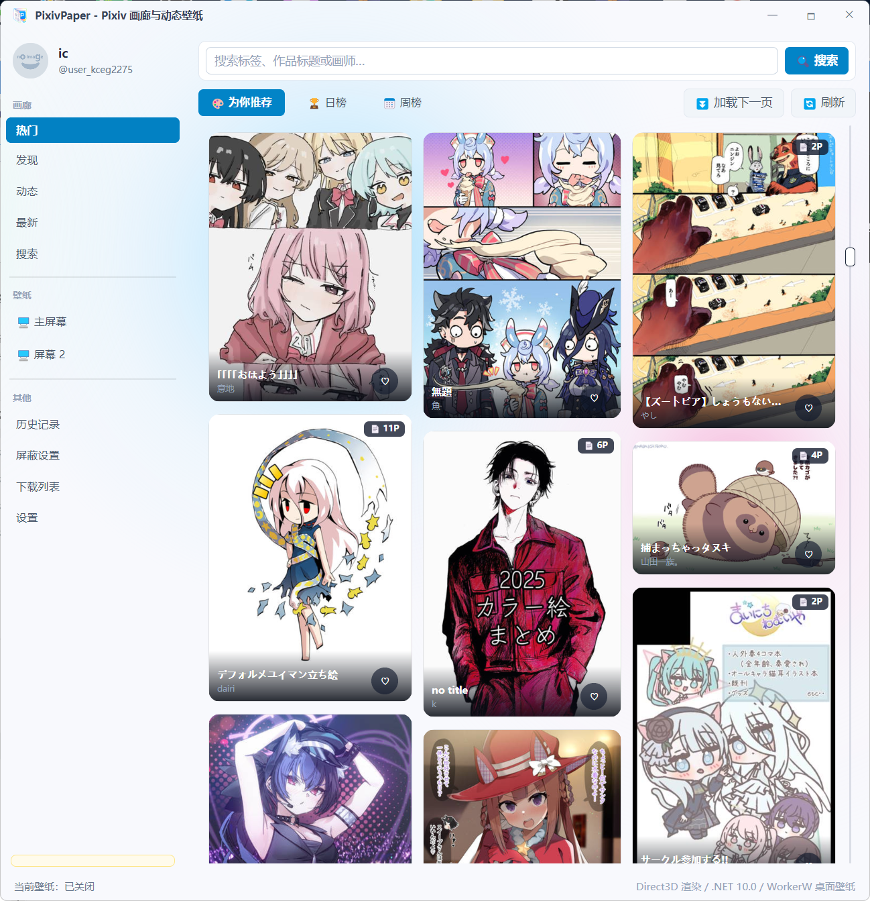
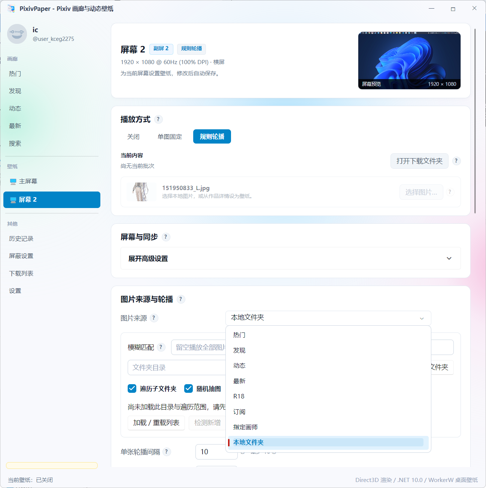
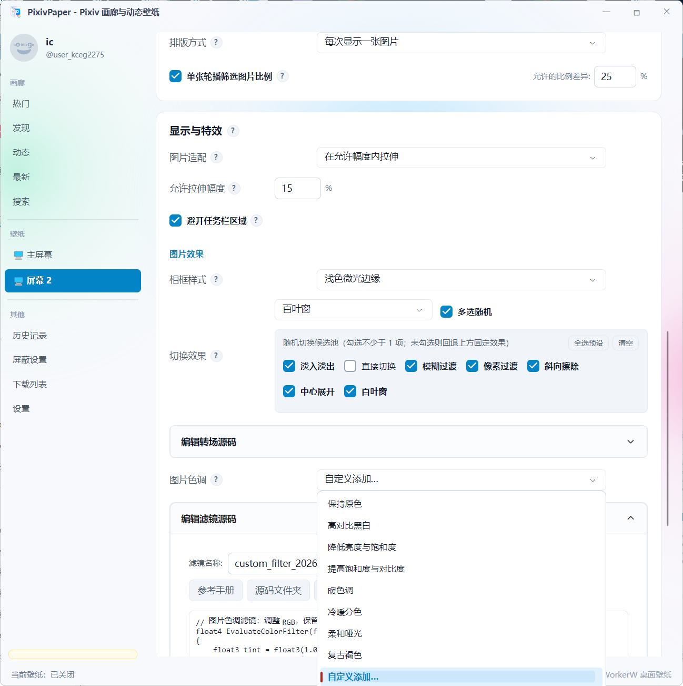
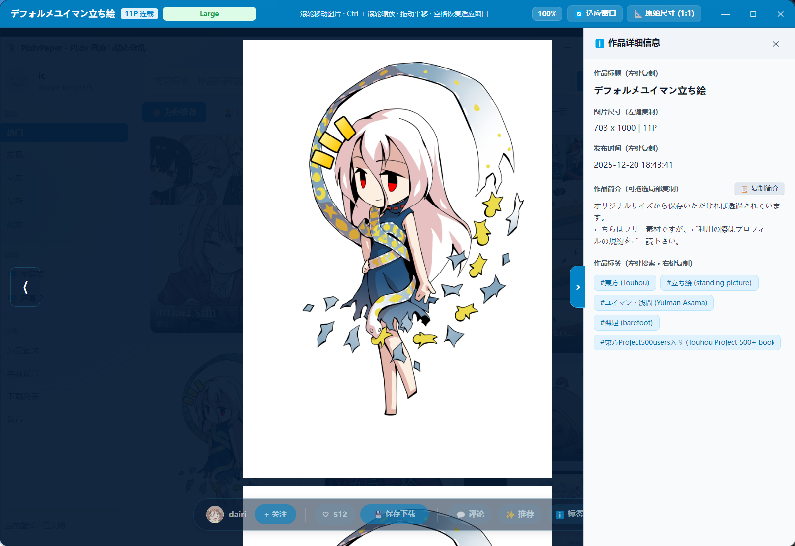
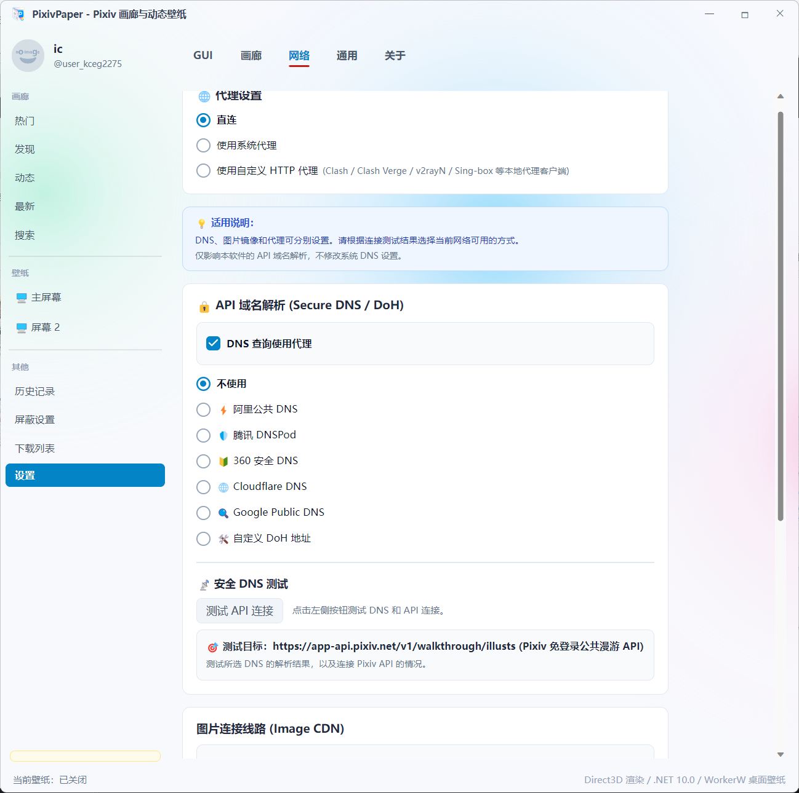

# PixivPaper

 

 

**PixivPaper** 是一个专为 Windows 打造的现代 Pixiv 画廊客户端与多屏动态壁纸引擎：瀑布流看图 · Ugoira 动图 · 幻灯片 · 搜索订阅 · D3D11 多图拼图壁纸 · 实时 HLSL 着色器 —— 不套壳 Electron，原生轻快。

支持 Windows 10 (1809+) / Windows 11 x64 · 内置 DoH 与图片镜像测速 · 免费无广告

---

**简体中文** | [English](./README.en.md) | [日本語](./README.ja.md) | [🖼️ 实机演示图集](./SHOWCASE.md) | [🗺️ 更新计划](./更新计划.md)

> [!NOTE]
> **公开预览与开源计划**：本应用是 [Pixiv](https://www.pixiv.net) 的非官方第三方桌面客户端，所有作品版权归各自创作者或 Pixiv 所有。
> 当前处于**公开预览测试阶段（Pre-1.0）**，暂仅提供可执行程序下载与问题反馈；预览版已先行接入**简体中文 / English / 日本語**三语临时界面（因预览期 UI 仍在迭代，后续部分新页面可能暂保留中文，完整校对与更多语言将在正式版 **v1.0** 逐步完善）。计划在**正式版（v1.0）发布时**正式公开全部源码。

 

<!-- 主视觉首页概览图 + 跳转动态壁纸 GIF 演示 -->

  
   
  🎬 <b>桌面动态壁纸实机效果</b>：点击前往 <a href="./SHOWCASE.md#wallpaper-live-demo"><code>SHOWCASE.md</code> 观看壁纸引擎演示动图（paper.gif）</a> &nbsp;|&nbsp; 📷 <a href="./SHOWCASE.md">浏览全部 14 张实机截图</a>

---

## ✨ 特性

### 逛 Pixiv，顺便把好图直接铺上桌面
从刷图、筛图、追更订阅到多屏桌面壁纸，把桌面端想做的事放进同一套原生应用里。

<table>
<tr>
<td width="50%" valign="top">

#### 🎯 顺滑瀑布流 · 冷启秒显
推荐流支持首屏磁盘快照缓存，冷启动先秒出上次内容，后台静默拉新；分桶滑窗虚拟化控制大列表内存，支持滚轮倍率（100% / 250% / 500%）与键盘翻页。

#### 🏆 榜单与全站浏览
覆盖为你推荐、日/周/月/原创/新人榜、关注画师动态、最新投稿、R-18 专区榜单与个人空间（主页/收藏/关注/投稿），历史中心自动记录浏览、壁纸与推荐足迹。

#### 🔍 精准搜索与标签筛选
支持同义词/翻译标签合并开关、投稿日期范围、年龄分级、按本人权限路由热度搜索、画师搜索与直达作品 ID；支持一键直跳 Pixiv 官网阅览范围设置。

#### 🎬 详情大图 · Ugoira · 幻灯片
缩略图先行占位、后台加载目标画质；支持多页漫画、**Ugoira 动图**原生播放与导出 GIF；内置详情**幻灯片模式**，可单独设定多图步进与动图循环等待规则，切走主标签后详情仍可后台续读。

#### 🙈 多层次本地屏蔽
支持手动屏蔽标签（SQLite 持久化 + **永久历史检索与恢复**）与可编辑的**屏蔽标签集**（预设、自建、停用单项、JSON/TXT 导入导出）；支持 UID 快添或预览屏蔽画师，按壁纸/画廊/发现/动态场景独立生效。

#### 📦 搜索订阅 · 自动追更归档
把任意搜索条件存为订阅，支持试运行预览候选作品与定时后台归档至独立子目录；手动与订阅共用下载队列并按来源筛选，支持原子落盘与带校验的目录迁移。

</td>
<td width="50%" valign="top">

#### 🖥️ 独立 D3D11 多屏壁纸宿主
壁纸渲染由独立的 `PixivPaper.ScreenHost` 进程承担，通过 `WorkerW` 与 DirectComposition / Direct3D 11 挂载桌面；主窗口最小化或关闭至托盘后壁纸依然独立运行。

#### 🧩 多屏独立与同步步进
每块显示器可单独配置固定作品或规则轮播，支持多屏同步组共享候选流步进（多屏不撞图）、任务栏工作区避让、指定显卡适配器与**全屏游戏/应用自动暂停**。

#### 🌊 8 大壁纸来源 / 18 条路径
支持推荐、各类榜单、关注动态、最新投稿、R-18 榜单、自定义搜索条件、指定画师，以及**本地文件夹索引**（解析本地文件名与 Windows 文件属性，自动检测新增图片）。

#### 🎨 单图适配与 5 种智能拼图
单图支持容差微调拉伸、等比留白、裁切与 1:1 原尺寸，并可过滤横竖比悬殊或超长条漫；内置**报纸画报**、**流光挂画**（零裁切）、**画廊行流**、**左右并列**、**上下堆叠** 5 种多图排版。

#### 🧪 软件内实时 HLSL 编辑器
嫌内置视效不够极客？直接在设置里修改**背景、转场、色调滤镜**的 HLSL 着色器代码，保存即编译校验生效，并配有非模态着色器参考手册随时查阅。

#### 📡 网络自检 · 代理与镜像测速
内置 WebView2 官方登录与 OAuth 自动续期；支持直连 / 系统代理 / 自定义 HTTP 代理、多组内置 **DoH** 与一键测速、多组**图片 CDN 镜像**与测速。

</td>
</tr>
</table>

---

## 🖼️ D3D11 壁纸引擎与 HLSL 视效

### 不止是“换一张图片”
硬件加速渲染管线让留白不再单调，让每一块屏幕都像定制展墙。👉 [**点击查看桌面动态壁纸实机演示 GIF (`paper.gif`) →**](./SHOWCASE.md#wallpaper-live-demo)

<table>
<tr>
<td width="50%" valign="top">

#### 🌌 11+ 种动态背景模式
- 纯色、流光背景（玄 / 虹）、深空繁星、极客星芒
- 侧边柔光、侧边浮尘、流动丝带、细线流光、浅海波光、柔彩渐变
- 支持自定义背景图片与自定义 HLSL 背景着色器

#### 🎞️ 转场、相框与色调滤镜
- **转场**：硬切、淡入淡出、像素归位、散景失焦、斜向擦除、中心展开、百叶窗
- **相框**：无边框、圆角微光彩条、古典画框
- **滤镜**：原画、日漫黑白印画、深宵暗调、鲜艳增强、复古暖纸、冷暖分色、柔和哑光、复古褐色

</td>
<td width="50%" valign="top">

#### ⚡ 实时 HLSL 编程定制
- 独立 `WallpaperShaderCompiler` 保存即校验编译，失败保留旧 Shader 防黑屏
- 开放 `%TIME%`、`%PROGRESS%`、`%SCREEN_WIDTH%`、`%IMG_RECT%` 等着色器宏与纹理采样
- 内置非模态 `ShaderHelpWindow` 随时对照语法与常量

#### 🚀 原生架构 · 非 Electron
- 基于 **.NET 10 NativeAOT** 与 **Avalonia 11 + FluentAvalonia**
- 配套独立跨平台控制台服务端 `BroadcastServer`（支持 LAN 广播与只读 JSON API）

</td>
</tr>
</table>

---

## 📱 界面预览

### 每一屏，都在实机运行
以下为精选核心功能画面；完整三语界面、详情右键/幻灯片、搜索订阅、屏蔽管理以及 **桌面壁纸动态演示 GIF** 请见 👉 [**实机截图与动态演示图集 (`SHOWCASE.md`)**](./SHOWCASE.md)。

<table>
<tr>
<td align="center" width="50%">
  
   <b>桌面壁纸 · 多屏与来源配置</b>
   独立管理每块屏幕 · 推荐 / 榜单 / 订阅 / 画师 / 本地文件夹
</td>
<td align="center" width="50%">
  
   <b>视效定制 · 实时 HLSL 编辑器</b>
   多选转场随机池 · 滤镜代码直改保存编译 · 非模态参考手册
</td>
</tr>
<tr>
<td align="center" width="50%">
  
   <b>看图详情 · 双语标签与信息抽屉</b>
   自适应大图看漫画/原图 · 标题简介一键复制 · 标签搜索与收藏
</td>
<td align="center" width="50%">
  
   <b>网络自检 · 代理、DoH 与镜像测速</b>
   支持直连/系统/自定义 HTTP 代理 · 多组 DoH 解析与 CDN 测速
</td>
</tr>
</table>

  <a href="./SHOWCASE.md#wallpaper-live-demo"><b>🎬 查看桌面动态壁纸实机演示 GIF (paper.gif)</b></a> &nbsp;·&nbsp; <a href="./SHOWCASE.md"><b>📷 查看全部 14 张界面截图 →</b></a>

<b>每一项功能的更多说明</b>

 

- **主界面画廊** —— 推荐流首屏磁盘缓存秒开、后台静默更新；支持推荐、榜单、关注动态、最新投稿与 R-18 专区，大列表使用分桶滑窗控制内存占用。
- **壁纸引擎与拼图** —— 独立 `ScreenHost` 子进程渲染，支持 8 大来源分组（含本地目录索引）、双秒数间隔（单图/多图独立节拍）、多屏同步防撞图与全屏游戏自动暂停。
- **HLSL 着色器定制** —— 客户端壁纸页直接展开背景、转场、色调滤镜代码编辑区，保存即时编译校验并热更新到桌面；语法说明以非模态参考窗常驻对照。
- **详情与幻灯片** —— 先显缩略图再换目标画质；幻灯片支持单页停留定时、多图“只播头图 / 完整逐页 / 小数秒快播”、动图“跳过 / 播完一轮再切”，并支持邻居作品及可选 Ugoira 预载。
- **屏蔽与订阅** —— 标签集支持预设与自建、JSON/TXT 导入导出、手动屏蔽历史一键恢复；搜索订阅将协议与本地状态分离，支持定时后台归档至独立子目录。

---

## ⬇️ 下载与使用

### 运行环境要求

- **操作系统**：Windows 10（版本 1809 / Build 17763 及以上，64 位）或 Windows 11
- **运行组件**：[Microsoft Edge WebView2 Runtime](https://developer.microsoft.com/microsoft-edge/webview2/)（Windows 11 默认已包含，用于官方页面登录）
- **显卡**：支持 Direct3D 11 的 GPU

### 快速开始

1. 前往 [GitHub Releases](https://github.com/ic3nya/PixivPaper/releases/latest) 下载最新的 `win-x64` 预览版压缩包。
2. 解压到任意文件夹（请保持 `PixivPaper.exe`、`PixivPaper.ScreenHost.exe` 与 `default-blocked-tag-presets.json` 在同一目录下）。
3. 运行 **`PixivPaper.exe`**，使用内置 WebView2 登录窗口登录 Pixiv 即可开始使用。

---

## ❓ 常见问题

<b>PixivPaper 是官方应用吗？</b>
 不是。PixivPaper 是一个非官方的第三方 Pixiv 桌面客户端与壁纸引擎。所有插画与动图作品版权归各自创作者或 Pixiv 所有，请仅用于个人欣赏。

<b>为什么现在只有安装包，没有公开源码？什么时候开源？</b>
 项目目前处于<b>公开预览测试阶段（Pre-1.0）</b>，核心架构与界面仍在根据实机反馈快速收敛。我们计划在<b>首个正式版（v1.0）发布时</b>正式开源全部项目代码。

<b>目前支持哪些语言？后续还会加入更多语言吗？</b>
 当前公开预览版已先行提供<b>简体中文 / English / 日本語</b>三语基础界面（预览期 UI 仍在调整中，新增功能页面可能暂时显示中文）；<b>完整文案校对及更多本地化语言将在正式版（v1.0）阶段逐步完善</b>。README 也同步提供中 / 英 / 日三语版本。

<b>为什么 Windows 首次打开会提示“未知发布者 / SmartScreen”？安全吗？</b>
 预览阶段暂未购买商业代码签名证书，未签名的 Windows 程序均会触发系统默认提示。你可以核对 Release 页面附带的 <code>SHA-256</code> 校验值与扫描报告后，点击「更多信息 → 仍要运行」。登录流程通过本地 WebView2 访问 Pixiv 官方 OAuth 页面完成，令牌与本地记录均保存在本机 <code>%LocalAppData%\PixivPaper\</code>。

<b>中国大陆网络环境可以直接用吗？</b>
 支持。设置内提供了直连 / 系统代理 / 自定义 HTTP 代理切换，并内置多组 DoH（AliDNS、DNSPod、360、Cloudflare、Google、自定义）与图片 CDN 镜像测速，可根据你的网络环境自由切换。

<b>壁纸引擎常驻后台会占很高内存或影响打游戏吗？</b>
 不会。主程序与壁纸渲染进程均采用 .NET 10 NativeAOT 原生编译，不含 Electron 浏览器内核；关闭主界面后仅留轻量的 <code>ScreenHost</code> D3D11 进程运行，且支持<b>检测到全屏应用/游戏时自动暂停壁纸渲染</b>。

<b>软件收费或有广告吗？</b>
 完全免费、无广告。当前预览期暂未开放赞助入口。

<b>遇到闪退或 Bug 如何反馈？</b>
 欢迎在 <a href="https://github.com/ic3nya/PixivPaper/issues">Issues</a> 提交复现步骤与截图；若发生崩溃，可附上 <code>%LocalAppData%\PixivPaper\logs\crash.log</code>（注意先抹除个人路径信息）。

---

## 🗺️ 路线图与开源计划

> 📋 **详细后续计划请查看：[更新计划.md](./更新计划.md)**

- [x] **核心引擎完成**：Avalonia 瀑布流画廊 + 独立 D3D11 多屏壁纸宿主 + 实时 HLSL 编辑器 + 搜索订阅与多层屏蔽体系
- [ ] **公开预览测试（当前阶段）**：收集实机兼容性、多屏渲染、网络与交互细节反馈并持续打磨
- [ ] **近期重点推进**（详见 [更新计划.md](./更新计划.md)）：
  1. 优化内存管理
  2. 完成订阅服务器和接收功能
  3. 完善壁纸功能，优化性能，优化逻辑 ← **完成这部分进行开源**
  4. 完善预热方案，以提升高延迟访问者的使用体验
  5. 完善多语言翻译，逐步支持更多语言
- [ ] **正式开源源码**：完成上述第 3 项壁纸核心功能与性能优化目标后正式公开源码

---

**欢迎下载预览版体验并提交使用反馈，关注 [更新计划](./更新计划.md) 获取后续开源进度**

&nbsp;

Powered by <a href="https://avaloniaui.net/">Avalonia</a> · <a href="https://github.com/amwx/FluentAvalonia">FluentAvalonia</a> · <a href="https://github.com/amerkoleci/Vortice.Windows">Vortice.Windows</a> · <a href="https://github.com/mono/SkiaSharp">SkiaSharp</a>

